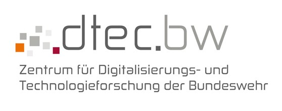

<!--
SPDX-FileCopyrightText: 2023 Dyne.org foundation

SPDX-License-Identifier: AGPL-3.0-or-later
-->

# zenflows-fabaccess

Interface between [interfacer-gui](https://github.com/interfacerproject/interfacer-gui) and
[FabAccess BFFH](https://gitlab.com/fabinfra/fabaccess/bffh) using the 
[python bindings](https://gitlab.com/fabinfra/fabaccess/pyfabapi) that verify the extistence
of a DID for the user using [did.dyne.org](explorer.did.dyne.org).

## Configuration

The configuration is done by providing environment variables.

Here is the list of them:

* `FAB_HOST` - hostname MQTT server
* `FAB_PORT` - port of MQTT server
* `FAB_USER` - valid username for bffh
* `FAB_USER` - valid password for bffh
* `DID_URL` - url for the DID controller
* `DELTA_TIMESTAMP` - how long is a request valid (in seconds)

## Examples

See the subdirectory `example/`.

## Acknowledgements

### Funding

#### October 2021 – March 2023

This project was funded by the European Regional Development Fund (ERDF) as part of the INTERFACER project.

#### January 2025 – December 2026

The further development of this project was supported as part of the "Fab City – Decentralized Digital Production for Urban Value Creation" project, funded by dtec.bw and supported by the European Union – NextGenerationEU.

  
  

